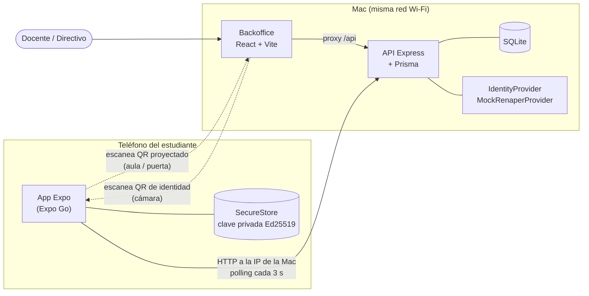
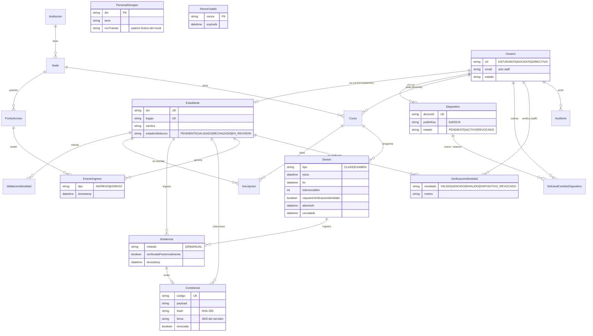
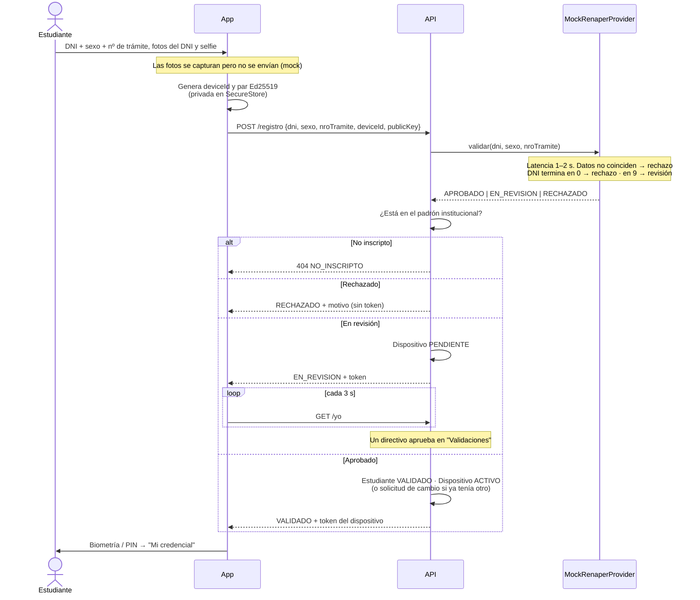
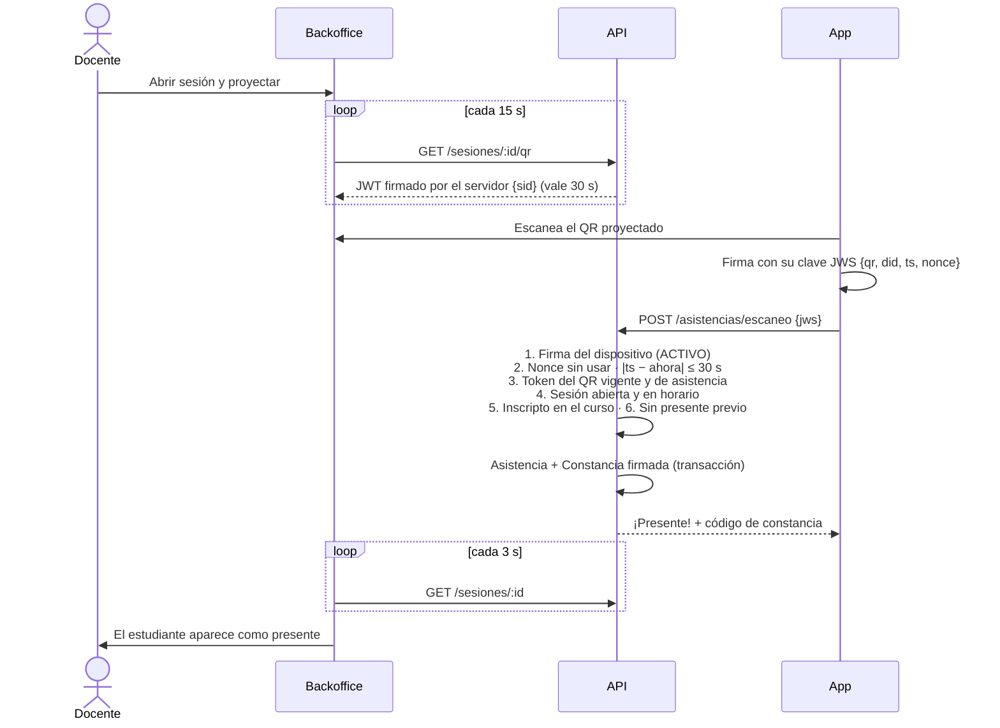
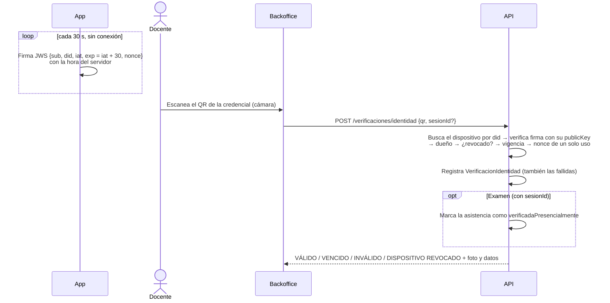
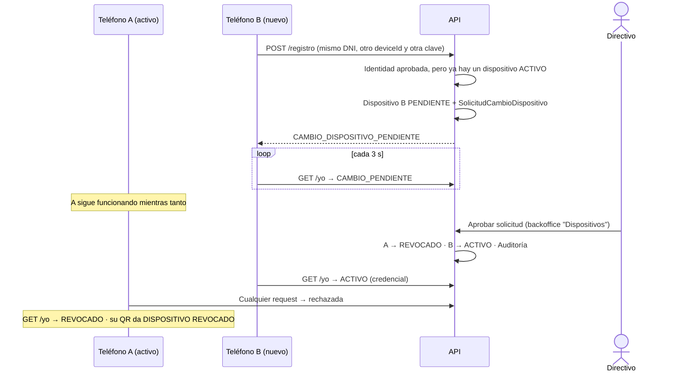

# PresenteID

Prototipo funcional para un trabajo práctico universitario: **identidad y presentismo estudiantil** desde el teléfono, inspirado en [POAP](https://poap.xyz) (*Proof of Attendance Protocol*).

- El estudiante **valida su identidad** una sola vez (contra un mock de RENAPER) y su teléfono pasa a ser su **credencial**: muestra un **QR de identidad dinámico** que un docente escanea para saber quién es.
- Con la misma app **escanea QRs** para dar **presente en el aula** o registrar su **ingreso a la sede**.
- Cada presente válido genera una **constancia de presencia** firmada digitalmente y verificable por cualquiera. Es la idea de POAP, pero **sin blockchain**: es un registro firmado por el servidor.
- Un **backoffice web** permite a docentes y directivos gestionar sesiones, proyectar el QR de asistencia, verificar identidades y consultar reportes.

> No es un producto productivo: **todos los servicios externos están mockeados** (RENAPER, biometría facial). Se priorizó una demo de punta a punta y una arquitectura fácil de explicar.

**Contenido:** [Funcionalidades](#funcionalidades) · [Arquitectura](#arquitectura) · [Modelo de datos](#modelo-de-datos) · [Flujos principales](#flujos-principales) · [Cómo correrlo](#cómo-correrlo) · [Usuarios de demo](#usuarios-de-demo) · [Guion de demo](#guion-de-demo) · [Seguridad](#seguridad) · [Decisiones de diseño](#decisiones-de-diseño)

## Funcionalidades

| Rol | Dónde | Qué puede hacer |
|---|---|---|
| **Estudiante** | App móvil (Expo) | Registrarse y validar su identidad; mostrar su credencial con QR dinámico (protegida con biometría o PIN); escanear el QR del aula (presente) y el de la puerta (ingreso o egreso); ver su historial y su galería de constancias. |
| **Docente** | Backoffice web | Ver sus cursos, crear sesiones (clase o examen), abrirlas y proyectar el QR de asistencia; ver los presentes en vivo y corregirlos (con auditoría); escanear credenciales (incluida la verificación cruzada en exámenes); grilla de asistencia con exportación a CSV. |
| **Directivo** | Backoffice web | Todo lo del docente sobre toda la institución, más: QRs de sede o puerta y reporte de ingresos, revisión manual de validaciones de identidad, aprobación de cambios de dispositivo y revocación, y log de auditoría. |

## Arquitectura



Monorepo `pnpm` con cuatro paquetes:

| Paquete | Qué es |
|---|---|
| `apps/api` | Express 5 + TypeScript, SQLite + Prisma. Firma tokens y documentos con `jose` (EdDSA). Tiempo real por polling, sin WebSockets. |
| `apps/backoffice` | React + Vite + Tailwind. Habla con la API por el proxy `/api` de Vite. Escanea con `html5-qrcode` y dibuja QRs con `qrcode.react`. |
| `apps/mobile` | Expo SDK 58, probado en Expo Go (sin módulos nativos propios): `expo-camera`, `expo-secure-store`, `expo-local-authentication`, `react-native-qrcode-svg`. |
| `packages/shared` | Tipos y enums de dominio, esquemas `zod`, formato de los QR y firma Ed25519/JWS sobre `@noble/ed25519` (JS puro). Se consume como TypeScript fuente, sin build. |

### Qué firma quién

Toda la seguridad se apoya en **dos claves Ed25519**:

| Quién firma | Clave | Qué firma | Quién verifica |
|---|---|---|---|
| **Servidor** | generada por `pnpm keys:generate` (en `apps/api/.env`) | tokens de sesión (backoffice y teléfono), **QR de asistencia** (rota cada 15 s), **QR de puerta**, **constancias** | la API; las constancias, cualquiera con la clave pública (`GET /public/clave-servidor`) |
| **Teléfono** | generada en el dispositivo; la privada nunca sale de SecureStore | **QR de identidad** (`{sub, did, iat, exp, nonce}`, rota cada 30 s, se genera sin conexión) y **cada escaneo** (`{qr, did, ts, nonce}`) | la API, con la clave pública registrada al vincular el teléfono |

El header `typ` de cada JWS distingue el uso (`presente-id+jws`, `presente-escaneo+jws`, `presente-asistencia+jwt`, `presente-puerta+jwt`, `presente-constancia+jws`), así un token no puede presentarse en lugar de otro.

## Modelo de datos

Los "enums" son `String` en SQLite y sus valores válidos están en `packages/shared/src/types.ts`.



`PersonaRenaper` es el padrón del mock y está **separado** del padrón institucional (`Estudiante`), para poder mostrar el caso "existe pero no está inscripto". `NonceUsado` guarda los nonces ya usados (antirreplay).

## Flujos principales

### a) Validación de identidad y vinculación del teléfono



### b) Presente en el aula



### c) Verificación de identidad por un docente



### d) Cambio de dispositivo



## Cómo correrlo

Requisitos: Node 20 o superior y pnpm 10 (`npm i -g pnpm@10`).

```bash
pnpm install
pnpm db:seed     # crea apps/api/.env (claves del servidor) y apps/mobile/.env (IP de la Mac) si faltan,
                 # resetea la base y carga datos de demo
pnpm dev         # API en :3000, backoffice en :5173 y Metro (Expo) en :8081
```

- Backoffice: http://localhost:5173 (abrilo en `localhost`: el navegador solo habilita la cámara en `localhost` o HTTPS).
- API: http://localhost:3000/health. Al arrancar, la consola muestra la URL con la IP de la Mac, que es la que va a usar el celular.

### App móvil (Expo Go)

1. Instalá **Expo Go** en el celular (tiene que ser la versión que soporta el SDK 58) y conectalo a la **misma red Wi-Fi** que la Mac.
2. Revisá que `apps/mobile/.env` apunte a la IP actual de la Mac (`EXPO_PUBLIC_API_URL=http://<ip>:3000`). Si cambiaste de red, editalo y reiniciá Metro. `BACKOFFICE_PUBLIC_URL` en `apps/api/.env` también usa esa IP (es el link de las constancias).
3. Para tener el QR de Expo interactivo, corré la app en una terminal aparte: `pnpm dev:mobile`. Escaneá el QR con la cámara (iOS) o con Expo Go (Android).

### Tests y otros comandos

```bash
pnpm test                                                   # todos (shared + API)
pnpm --filter @presente/api test -- asistencias             # archivos de test que matchean "asistencias"
pnpm --filter @presente/api exec vitest run --project unit  # solo unitarios (sin base de datos)
pnpm typecheck
pnpm keys:generate                                          # regenera las claves del servidor (invalida tokens y constancias)
```

- **Unitarios:** firma Ed25519/JWS y base64url (`shared`), reglas del mock de RENAPER, validación del QR de identidad, del escaneo firmado y de la ventana horaria de las sesiones.
- **Integración** (supertest, sobre `prisma/test.db`): auth y roles, registro y vinculación de dispositivo, verificación de identidad, presente por QR (incluidos replay, firma ajena, sesión cerrada y verificación cruzada), constancias (adulteración y revocación), ingresos, reportes, modo demo y auditoría.

La colección de requests está en [`api.http`](api.http) (REST Client de VS Code o cliente HTTP de JetBrains).

## Usuarios de demo

Backoffice (contraseña `demo1234` para todos):

| Email | Rol |
|---|---|
| `directora@presente.edu.ar` | Directivo |
| `docente1@presente.edu.ar` | Docente (Programación II, Bases de Datos) |
| `docente2@presente.edu.ar` | Docente (Redes y Comunicaciones) |

Estudiantes para registrarse en vivo desde la app. El número de trámite es `00` + los últimos 3 dígitos del DNI + los primeros 6:

| DNI | Sexo | Nº de trámite | Resultado esperado |
|---|---|---|---|
| 44901231 | F | 00231449012 | Aprobado |
| 44012342 | M | 00342440123 | Aprobado |
| 45123453 | F | 00453451234 | Aprobado |
| 45234560 | M | 00560452345 | Rechazado (DNI termina en 0) |
| 45345670 | F | 00670453456 | Rechazado (DNI termina en 0) |
| 46456789 | M | 00789464567 | En revisión manual (DNI termina en 9) |
| 46567899 | F | 00899465678 | En revisión manual (DNI termina en 9) |
| 38765435 | M | 00435387654 | "No estás inscripto" (existe en RENAPER, no en la institución) |

Hay además 8 estudiantes ya validados, con dispositivo vinculado e historial de presentes, constancias e ingresos, para que los reportes no estén vacíos. El seed crea tres sesiones **de hoy, relativas a la hora en que corre**: una clase de Programación II (empezó hace 15 min), un examen de Bases de Datos que exige verificación de identidad, y una clase de Redes que empieza en una hora.

## Guion de demo

Duración aproximada: 15 minutos. Hace falta la Mac con el backoffice y un celular con Expo Go.

**Preparación:** corré `pnpm db:seed` poco antes de la demo, así las sesiones "de hoy" coinciden con la hora. Después `pnpm dev` y `pnpm dev:mobile`. Abrí el backoffice como `docente1@presente.edu.ar` en una ventana y como `directora@presente.edu.ar` en otra (incógnito).

1. **Validación rechazada.** En la app, registrate con **45234560 · M · 00560452345**, pasá los pasos de fotos ("Sacar foto" o "Simular foto") y mirá la latencia del "RENAPER": *"La prueba de vida no coincide…"*. Tocá "Revisar mis datos".
2. **Validación aprobada.** Registrate con **44901231 · F · 00231449012**. La app pide biometría o PIN y muestra **Mi credencial** con el QR que rota cada 30 s.
3. **Verificar identidad.** Como docente, entrá a **Verificar identidad** y escaneá el celular: **VÁLIDO**, con foto y datos.
   - Tocá "Escanear otro" y escaneá **el mismo QR** antes de que rote: **INVÁLIDO** ("ya fue escaneado"). Es lo que pasaría con un QR reenviado por WhatsApp.
   - Sacale una captura al QR. En el panel de demo de la app tocá "Reloj +2 min" y escaneá la captura: **VENCIDO**. Después, "Hora real".
4. **Presente en el aula.** En el dashboard, abrí **Programación II**, tocá "Abrir sesión" y luego "Proyectar a pantalla completa". En la app, pestaña **Escanear**: sello **¡Presente!** con constancia emitida. En la lista del backoffice el estudiante aparece en unos 3 s. Si escaneás otra vez: *"Ya tenés el presente"*.
5. **Examen con verificación cruzada.** Abrí el examen de **Bases de Datos**, dá presente desde la app (queda "Sin verificar") y en el panel **Verificación de identidad** escaneá la credencial: pasa a **✓ Identidad**.
6. **Constancia verificable.** En la app, pestaña **Constancias**, tocá la insignia y escaneá su QR con otra cámara (o "Abrir verificación"): **Constancia auténtica**, sin datos sensibles. En la sesión en vivo, **anulá** ese presente con un motivo y recargá la verificación: **Constancia revocada**.
7. **Ingreso a sede.** Como directora, en **Ingresos → Puertas**, tocá "Ver QR" en "Acceso biblioteca" (rotativo) y escanealo desde la app: **Ingreso registrado**. Escaneá otra puerta: **Egreso**. El reporte por sede y franja horaria se actualiza solo.
8. **Cambio de dispositivo.** En la app, en el panel de demo, tocá "Desvincular (borrar claves)" y registrate de nuevo con 44901231. Como el teléfono ahora es "otro" (otra clave y otro `deviceId`), queda en **Cambio de dispositivo pendiente**. La directora lo aprueba en **Dispositivos** y la app pasa sola a la credencial.
9. **Revisión manual.** Desvinculá de nuevo y registrate con **46456789 · M · 00789464567**: queda **en revisión**. La directora lo aprueba en **Validaciones** (con la foto del padrón para comparar) y la app se actualiza sola.
10. **Dispositivo revocado.** Sacale una captura a la credencial. En el panel de demo, tocá "Revocar este teléfono": la app muestra **Dispositivo desvinculado**. Escaneá la captura desde el backoffice: **DISPOSITIVO REVOCADO**.
11. **Reportes y auditoría.** Recorré el **Dashboard**, la **Asistencia** (exportá el CSV y abrilo en Excel) y la **Auditoría**, filtrando por verificaciones, correcciones, dispositivos y demo.

## Modo demo

Con `DEMO_MODE=true` (API) y `EXPO_PUBLIC_DEMO_MODE=true` (app):

- **App:** se puede **simular un escaneo** pegando el contenido del QR (útil en un emulador sin cámara) y **simular las fotos** del registro. Además, la credencial tiene un panel para **mover el reloj** del servidor, **revocar este teléfono** y **desvincularlo** (borrar sus claves y actuar como un teléfono nuevo).
- **Backoffice:** el menú **Modo demo** permite **adelantar o atrasar el reloj del servidor** y **forzar una sesión como vencida**. Mientras el reloj está desfasado se ve un banner arriba de todo. Para revocar un dispositivo se usa la pantalla **Dispositivos**.
- **Geolocalización:** no está implementada (quedó fuera del alcance simplificado), así que no hay forzado "fuera de rango".

Todas las validaciones de tiempo de la API pasan por `clock.now()`. Mover el reloj afecta a todo de forma coherente, y la app se sincroniza con la hora del servidor en el siguiente `GET /yo`.

## Seguridad

Es un prototipo, pero el diseño intenta ser explicable y honesto sobre sus límites.

### Ataques que mitiga

| Ataque | Cómo se mitiga |
|---|---|
| **Captura de pantalla del QR de identidad** | El QR rota cada 30 s y el servidor exige `exp − iat ≤ 30 s` (más 5 s de tolerancia). Una captura vieja da **VENCIDO**. |
| **Compartir el QR por WhatsApp** (identidad) | Cada QR lleva un **nonce de un solo uso**: el segundo escaneo del mismo código da **INVÁLIDO**, aunque esté vigente. |
| **Falsificar un QR de identidad** | Lo firma la clave privada del teléfono y se verifica con la clave pública registrada al validar la identidad. Sin la clave, la firma no valida. |
| **Prestar la cuenta / iniciar sesión en otro lado** | Los estudiantes no tienen login web. La sesión de la app es un token atado a un `deviceId`, y en cada request se exige que ese dispositivo esté **ACTIVO**. Además, la credencial se abre con **biometría o PIN**. |
| **Usar dos celulares** | **Un solo dispositivo activo por usuario.** Registrarse desde otro teléfono genera una solicitud que tiene que aprobar un directivo, y al aprobarla el anterior queda revocado. |
| **Copiar el token del QR del aula y enviarlo "a mano" a la API** | El presente no se acepta con el token suelto: tiene que venir dentro de un **JWS firmado por el teléfono vinculado** (`did` y firma), con hora acotada (±30 s) y nonce. |
| **Reenviar un escaneo firmado (replay)** | Nonce de un solo uso y ventana temporal en el escaneo, más unicidad `(estudiante, sesión)` en la base. |
| **Teléfono perdido o robado** | Un directivo lo **revoca** y queda inutilizable al instante, aunque su token no haya vencido. La clave privada está en SecureStore (Keychain/Keystore) y no viaja en backups (`WHEN_UNLOCKED_THIS_DEVICE_ONLY`). |
| **"Des-validar" a otro estudiante conociendo su DNI** | Un intento fallido queda registrado, pero no cambia el estado de quien ya está `VALIDADO`. |
| **Adulterar una constancia** | Está firmada por el servidor y se guarda su SHA-256. La verificación pública detecta cualquier cambio en la base, y la firma se puede verificar por fuera con la clave pública. |
| **Usar un tipo de token en lugar de otro** | Cada JWS lleva un `typ` distinto y cada endpoint exige el suyo (por ejemplo, un QR de asistencia no sirve en una puerta). |
| **Correcciones de asistencia sin rastro** | Toda corrección manual exige motivo y queda en la auditoría con el estado anterior, igual que los cambios de dispositivo, las validaciones y cada verificación de identidad. |

### Lo que NO mitiga (limitaciones conocidas)

- **Validación de identidad simulada:** el mock decide por reglas sobre el DNI. Las fotos del DNI y la selfie no se procesan (no hay OCR, prueba de vida ni comparación facial), así que en este prototipo cualquiera que conozca DNI, sexo y nº de trámite de un estudiante puede validarse en su lugar. Con un proveedor real se reemplaza solo la implementación de `IdentityProvider`.
- **Reenviar el QR proyectado en tiempo real:** un compañero en el aula puede fotografiar el QR de asistencia y mandarlo al instante a alguien que está en su casa, que lo escanea con **su propio** teléfono vinculado dentro de los 30 s. La rotación achica la ventana pero no la cierra. Sin geolocalización, la mitigación es la **verificación cruzada de identidad**, que es obligatoria en exámenes.
- **Foto del QR impreso de una puerta:** los QR estáticos valen un año. Una foto permite registrar un ingreso a distancia, aunque desde el teléfono del propio estudiante. Para puertas sensibles conviene el modo rotativo.
- **Prestar el teléfono desbloqueado:** si el dueño desbloquea la app y presta el celular, el sistema no lo distingue. Si el teléfono no tiene ningún bloqueo configurado, la app avisa pero deja pasar.
- **Teléfonos con root o jailbreak:** podrían extraer la clave privada de SecureStore. No hay atestación de dispositivo (Play Integrity / App Attest).
- **Infraestructura de prototipo:**
  - todo viaja por HTTP en la red local (sin TLS);
  - el token del backoffice vive en `localStorage` (expuesto ante un XSS);
  - los tokens de staff no se pueden revocar antes de su vencimiento (8 h);
  - no hay rate limiting ni bloqueo por intentos fallidos;
  - SQLite y una sola instancia;
  - la clave del servidor está en un `.env`, no en un KMS/HSM;
  - con `DEMO_MODE=true`, cualquier usuario logueado puede mover el reloj del servidor.

## Decisiones de diseño

- **Enums como `String`:** SQLite + Prisma no tiene enums nativos. Los valores válidos están en `packages/shared/src/types.ts` y se validan con zod.
- **Una sola clave de servidor (Ed25519):** firma los tokens de sesión del backoffice y de los teléfonos, los QR de asistencia y de puerta, y las constancias. El header `typ` de cada JWS distingue el uso, para que un tipo de token no se acepte en lugar de otro. Las claves se generan por script y viven en `apps/api/.env`.
- **Reloj único (`clock.now()`):** todas las validaciones de tiempo pasan por él. En `DEMO_MODE` se puede adelantar para mostrar QRs vencidos o sesiones fuera de horario sin esperar.
- **Fechas del seed relativas al momento en que corre:** siempre hay tres sesiones "de hoy" (una clase de Programación II, un examen de Bases de Datos que exige verificación de identidad y una clase de Redes más tarde), más historial de la última semana.
- **Programación II tiene inscriptos a todos los estudiantes:** así cualquiera que se registre en vivo puede dar presente en la demo.
- **Padrón RENAPER separado del padrón institucional** (`PersonaRenaper` frente a `Estudiante`): permite demostrar el caso "existe pero no está inscripto".
- **Fotos de los estudiantes:** placeholders de `i.pravatar.cc`. Requieren conexión a internet para verse.
- **Backoffice detrás del proxy de Vite (`/api`):** evita CORS y no hay que configurar la URL de la API. Vite corre con `--host` para que la página pública de verificación de constancias se pueda abrir desde un celular.
- **Login de staff con mensaje genérico:** "Email o contraseña incorrectos" en todos los casos. Los estudiantes no tienen credenciales web y el login rechaza su rol explícitamente.
- **`node-linker=hoisted`:** Metro (Expo) no resuelve bien los symlinks de pnpm.
- **Orden de la validación:** primero se consulta al proveedor de identidad y después el padrón institucional. Así el caso "existe en RENAPER pero no está inscripto" devuelve `NO_INSCRIPTO`, y un DNI inexistente en RENAPER se informa como rechazo.
- **Fotos del DNI y selfie:** se capturan con la cámara pero no se envían al servidor. El mock decide solo por reglas sobre el DNI.
- **Un intento fallido no "des-valida":** si alguien ingresa el DNI de un estudiante ya validado con datos incorrectos, se registra el intento pero el estudiante sigue `VALIDADO`.
- **Claves del dispositivo:** la clave privada son 32 bytes de `expo-crypto` (CSPRNG del sistema) y se guarda en SecureStore con `WHEN_UNLOCKED_THIS_DEVICE_ONLY`, así que no viaja en backups. Al servidor solo llega la clave pública.
- **Sesión del teléfono:** el token del dispositivo (30 días) está atado a un `deviceId`, y en cada request se verifica en la base que ese dispositivo siga `ACTIVO`. Revocar corta el acceso de inmediato, sin esperar a que venza el token.
- **Cambio de dispositivo solo con aprobación de un directivo:** descartamos la alternativa de re-validar con el mock. Si hay varias solicitudes pendientes, la más nueva reemplaza a las anteriores, que se rechazan.
- **Revisión manual:** el teléfono queda `PENDIENTE` hasta que un directivo resuelve, y la app consulta `GET /yo` cada 3 s.
- **Biometría:** `expo-local-authentication`, con el PIN del teléfono como alternativa. Si el teléfono no tiene ningún bloqueo configurado, se avisa y se deja pasar (decisión de prototipo). La credencial se vuelve a bloquear al pasar la app a segundo plano.
- **Navegación de la app sin librería:** una máquina de estados en `App.tsx` decide la pantalla según el token local y la respuesta de `GET /yo`. Reemplaza a `expo-router`, que habíamos propuesto originalmente, porque es más simple de explicar y no necesita configuración.
- **QR de identidad firmado por el teléfono, no por el servidor:** es un JWS EdDSA estándar (`typ: presente-id+jws`) con `{sub, did, iat, exp, nonce}`, firmado con la clave privada del dispositivo. Se genera sin conexión, y verificarlo prueba a la vez la identidad y que salió del teléfono vinculado. La implementación usa `@noble/ed25519` en `packages/shared`, igual en la app y en la API, y es compatible con `jose` (hay un test que lo comprueba).
- **Vigencia del QR de identidad:** rota cada 30 s. El servidor acepta 5 s extra por la demora del escaneo y rechaza QRs con `exp − iat > 30` o con `iat` en el futuro, para que un teléfono no pueda autoemitirse un QR "eterno".
- **Reloj del teléfono sincronizado:** cada `GET /yo` trae la hora del servidor y la app firma con esa hora corregida. Así un teléfono atrasado no genera QRs que ya nacen vencidos.
- **Nonce de un solo uso:** cada nonce se guarda en `NonceUsado` hasta que su QR vence. Si el mismo QR se escanea dos veces (por ejemplo, reenviado por WhatsApp), el segundo escaneo da `INVALIDO`.
- **Qué muestra cada resultado:** si la firma es auténtica, el backoffice muestra los datos del estudiante incluso con `VENCIDO` o `DISPOSITIVO_REVOCADO`, porque se sabe de quién es el QR. Con `INVALIDO` por firma o formato no muestra ningún dato. Todas las verificaciones quedan registradas, también las fallidas.
- **Verificación manual en el backoffice:** además de la cámara, se puede pegar el contenido del QR, para equipos sin webcam o para probar con `api.http`.
- **QR de asistencia firmado por el servidor:** es un JWT EdDSA (`typ: presente-asistencia+jwt`) con el `sid` de la sesión. El backoffice pide uno nuevo cada 15 s, pero cada token vale 30 s, así que se acepta el QR actual y el anterior y nadie queda afuera por escanear justo en la rotación.
- **El presente lo firma el teléfono:** la app no manda el token del QR suelto, lo envuelve en un JWS (`typ: presente-escaneo+jws`) con `{qr, did, ts, nonce}` firmado con la clave del dispositivo. Así un token copiado del proyector y enviado desde otro lado no sirve. El servidor exige `|ts − ahora| ≤ 30 s` y un nonce sin usar.
- **Orden de validación del presente:** firma del dispositivo, nonce, token del QR (vigente y de asistencia), sesión abierta y en horario, inscripción y, por último, sin duplicado (`@@unique(estudianteId, sesionId)`). Cada falla devuelve un `codigo` distinto (`QR_VENCIDO`, `SESION_CERRADA`, `NO_INSCRIPTO_CURSO`, `YA_PRESENTE`…) que la app muestra.
- **Ventana de la sesión:** un presente por QR es válido si el docente abrió la sesión, no la cerró y `ahora ∈ [inicio − tolerancia, fin]`. Abrir y cerrar son acciones explícitas, y una sesión cerrada se puede reabrir.
- **Exámenes:** el estudiante da presente con el QR del aula, y el docente escanea su credencial desde "Sesión en vivo" para marcar el presente como verificado presencialmente. Si el estudiante no dio presente, la verificación lo informa pero no lo crea. Los exámenes exigen esta verificación por defecto.
- **Correcciones manuales:** marcar o anular un presente exige un motivo y queda en `Auditoria` con el estado anterior. Al anular se borra la asistencia, pero su constancia no: queda revocada.
- **La app decide a dónde mandar cada QR leyendo el `typ` del header**, sin verificarlo: la verificación siempre la hace el servidor.
- **Constancias (estilo POAP, sin blockchain):** cada presente, sea QR o manual, emite una constancia con datos públicos (evento, curso, sede, aula, fecha y titular abreviado como "Camila F.", sin DNI ni legajo). El servidor la firma como JWS EdDSA y se guarda junto con su SHA-256. La verificación pública (`/verificar/:codigo`) comprueba la firma y que el contenido firmado coincida con lo guardado, así que una edición manual de la base se detecta. La clave pública está en `GET /public/clave-servidor` para verificarla por fuera.
- **Constancia revocada en lugar de borrada:** si el docente anula el presente, el link público sigue respondiendo y muestra "revocada", y la constancia desaparece de la galería de la app. Por eso `Constancia.asistenciaId` es opcional (`onDelete: SetNull`) y la constancia guarda su propio `estudianteId`.
- **Código público corto (`XXXX-XXXX`):** usa un alfabeto sin caracteres ambiguos (sin 0/O ni 1/I/L), así se puede dictar o tipear.
- **QR de puerta:** el servidor firma un JWT `presente-puerta+jwt` con el `pid` del punto de acceso. Los **estáticos** (para imprimir) valen un año. Los **rotativos** (para una pantalla en la entrada) rotan cada 15 s y valen 30 s, igual que el de asistencia. El escaneo pasa por la misma firma del dispositivo y el mismo antirreplay que el presente.
- **Ingreso o egreso automático:** el tipo se alterna según el último evento del día del estudiante, en cualquier sede: si el último fue un ingreso, el siguiente es un egreso. Escanear la misma puerta dentro de los 60 s siguientes se rechaza, para que un doble escaneo accidental no registre "entró y salió".
- **Limitación conocida, QR de puerta impreso:** como no hay geolocalización, una foto del QR estático permite registrar un ingreso sin estar en la puerta. Igual tiene que hacerlo el teléfono vinculado del propio estudiante. Para puertas sensibles conviene el modo rotativo.
- **Reportes:** el % de asistencia es presentes sobre inscriptos. El del dashboard toma las sesiones terminadas en los últimos 7 días; la grilla, las sesiones ya empezadas. Por eso las sesiones de hoy en curso aparecen con ausentes hasta que la gente da presente. Como los estudiantes del seed sin validar nunca dan presente, los porcentajes del seed son bajos a propósito.
- **CSV de asistencia:** P = QR, M = manual, A = ausente. Incluye BOM UTF-8 para que Excel muestre bien los acentos.
- **Página pública dentro del backoffice:** `/verificar/:codigo` se resuelve antes del login. La verificación de identidad del staff pasó a `/verificar-identidad` para no confundirse con ella.
- **Modo demo:** el desfase del reloj vive en memoria (se pierde al reiniciar la API) y lo puede mover tanto el staff como la app. Forzar una sesión como vencida mueve su `fin` a un minuto atrás. Todo queda auditado con la categoría "Modo demo". Con `DEMO_MODE=false`, los endpoints `/demo/*` responden 404.
- **Auditoría unificada:** la pantalla une la tabla `Auditoria` (correcciones, dispositivos, validaciones, sesiones, demo) con `VerificacionIdentidad`, que tiene su propia tabla porque guarda datos estructurados (resultado, sesión, dispositivo).
- **Sin geolocalización ni rol Admin:** quedaron fuera por la sección "Stack (simplificado)" del enunciado. Los usuarios, cursos y sedes se cargan por seed.
- **Tests:** dos proyectos de Vitest en la API. `unit` (`*.unit.test.ts`) no usa base de datos; `integration` resetea `test.db`, carga el seed una vez y usa un par de claves fijo solo para tests. Las suites comparten la base, así que cada una usa estudiantes distintos (ver `apps/api/src/test/helpers.ts`).
